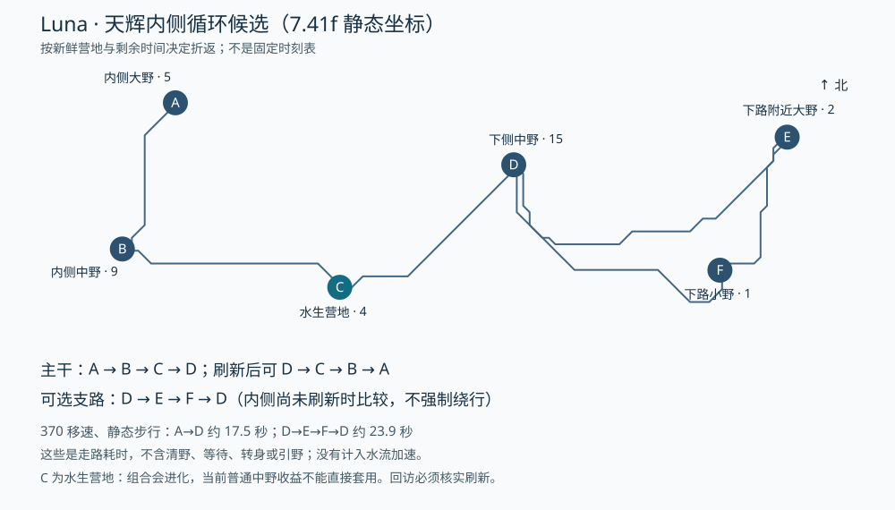

# Luna 7.41f：录像核验与 940 金结论更正

记录日期：2026-11-15。研究记录，不是通过实机验收的收益标定。

## 1. 撤回的结论

用户场景：天辉、Luna 10 级、满级月刃、已点 10 级天赋、动力鞋和疯狂面具，寻找三分钟野怪掉落金钱最多的路线。

此前“约 940 金”的依据是 `.tmp/luna-scenario.ts` 专项实验：

- 额外假定敏捷鞋、月刃衰减天赋、10:00 开始、满血蓝、无预先堆野。
- 专项脚本补了部分疯脸、先天和天赋效果，但没有接入生产代码。
- 没有主动环月、途中升级、引野合拉、真实野怪技能/光环；掉落组合概率也未核验。
- 对每类营地分别取各组合的最长时间、最低剩余血量，再跨营地串联；这种保守包络不是一场真实战斗序列。
- 生产代码仍没有疯脸主动/吸血和动力鞋切换属性支持，不能拿这个实验结果证明生产模型支持了该配置。

因此 **942 金只是上述不完整模型找到的候选收益，不应再作为这个英雄配置的实际收益预期、实测基准或理论上限**。不能通过凭空乘一个系数把它“修正”为用户期待的数字；先补机制并用可比样本验收。

## 2. 实际找到和检查的录像

### 职业选手录像：只核验了页面，未读取到可播放画面

1. YouTube `i3TR4IWT4Tk`：标题标注 Satanic、Luna、7.41F，页面发布日期 2026-09-18。描述中的版本只写 7.41，故子补丁依赖上传者标题，未通过比赛 ID 或回放验证。
2. YouTube `lVzNTQ-5H9k`：Miracle- Luna，描述标注 7.41f，页面发布日期 2026-09-15。比赛 ID/完整回放入口需要频道会员，本次没有获取。

本次公开播放器响应要求登录确认；没有取得可核验的视频流。因此 **不能声称已经看完职业选手这两个录像，也不能从其标题或简介推出三分钟纯打野收益**。

原始页面：

- `https://www.youtube.com/watch?v=i3TR4IWT4Tk`
- `https://www.youtube.com/watch?v=lVzNTQ-5H9k`

### 实际读取画面的样本：B 站教学视频，不标成职业选手样本

- BVID：`BV1diag6gE9D`。
- 内容：7.41F 露娜劣势早进野、大隐刀出装教学；上传者“青青青择”。
- 发布：2026-09-25；视频长 1918 秒；CID `42180019693`。
- 版本依据：上传者标题；尚未通过比赛回放验证子补丁。
- 实际读取公开 480p 视频，抽帧核对游戏时钟、英雄等级、补刀、击杀/死亡/助攻、净资产及装备栏。
- 播放有倍速和暂停，**不能把视频时间差当成游戏时间差**。

| 视频位置 | 游戏时钟 | Luna 等级 | 净资产面板 | 正补 | K/D/A |
|---|---|---:|---:|---:|---|
| 09:00 | 12:17 | 11 | 6075 | 126 | 1/1/0 |
| 11:00 | 14:49 | 13 | 8057 | 177 | 1/1/1 |

两帧之间游戏经过 152 秒，面板净资产增长 1982，正补增长 51。**这不是 1982 金纯野收益的证据**：

- 两帧之间有助攻，可能有兵线、团队奖励等其他收入；未逐事件分账。
- 起点已是 11 级，终点 13 级；装备栏也发生变化，不是固定 10 级仅两件装备。
- 净资产不是钱包；购买/出售、消耗品、团队奖励与不同收入来源需单独核对。
- 只读两帧不能还原所有营地、施法、野怪组合和刷新，不能据此宣称全程最优路线。

后续放大原始 HUD 更正：14:49 的助攻数是 **1**，不是最初读出的 2；“期间存在其他收入，不能把净资产变化当纯野”的结论不变。

原始页面/元数据：

- `https://www.bilibili.com/video/BV1diag6gE9D/`
- `https://api.bilibili.com/x/web-interface/view?bvid=BV1diag6gE9D`

本机研究素材位于 `.tmp/luna-video-research/`，未加入版本控制，也未部署为公开资源。包括元数据、临时视频、两张明确视频位置的截图及对照图；这些临时文件不是 CI 依赖。

## 3. 下一轮可比实验

1. **固定配置实验**：自定义局录制 Luna 10 级、满月刃、明确哪边天赋、敏捷鞋和疯脸；补齐其余技能等级、初始血蓝、游戏时钟、起点和营地/堆野状态。明确是否使用主动环月，三分钟内保持等级装备固定。
2. **真实发育实验**：同样的起始配置，但允许升级和买装；每次升级、购买、技能/疯脸施放均记录，不与固定配置结果混报。
3. **按收入来源统计**：野怪实际击杀赏金为主指标；自然工资、兵线、英雄击杀/助攻、建筑、赏金符及其他团队奖励单列，不能拿净资产变化或整局 GPM 代替。
4. **逐动作校准**：记录路径、接敌点、先打哪个单位、引野距离、技能/疯脸起止、野怪死亡、离开刷新框时刻；对照相同输入的仿真，而非只对齐总金额。
5. **先单营地后连续路线**：先核验攻击面板、清野时间、血蓝，再比较含刷新回访的连续 180 秒序列；报告偏差及缺项，不以通过合成单元测试代替录像/实机验收。
6. **纯野与线野分开**：研究职业发育可以包括线野结合，但用户此次“在天辉刷野”的纯野目标不能悄悄加入兵线收益。

## 4. Astra 规划方向

用户已允许使用 GPT-6 Astra。2026-11-15 已实际读取官方模型文档与 function calling 指南：

- `https://developers.openai.com/api/docs/models/gpt-6-astra`
- `https://developers.openai.com/api/docs/guides/function-calling`

文档确认模型 ID `gpt-6-astra`；Astra 的工具调用走 Responses API。模型页不是本项目 Azure 资源部署清单，当前可用性与实际部署名仍需单独验证。

采用“模型提出/改进策略 → 工具核算 → 模型根据反馈继续搜索 → 服务端复核”的方向。不能仅把原来的少量候选交给更强模型打分，也不能把不支持的机制交给模型凭经验补数字。接口、异步过期处理和成本边界见 [刷野路线规划 §3](jungle-route-planner.md#3-大模型怎么用)。

**本轮只完成研究与设计修正，没有接通 Astra API，也没有用录像得到新的、可验证的两件装三分钟纯野总金钱。**

## 5. 后续逐段分析：不再只对比两个净资产数

同日继续读取原视频，抽取视频 04:20–06:35、06:30–12:30 区间的连续定间隔画面，并对 08:52–09:02 每两秒精确取帧。视频有暂停、倍速和回看；以下均优先读**游戏内时钟**，不把播放时间当作游戏时间。职业选手录像仍未成功播放，本节分析的是上述教学样本。

### 可以从画面确认的动作

| 视频位置 | 游戏时钟 | 正补 | 画面观察 |
|---|---|---:|---|
| 08:52 | 12:05 | 121 | 向内侧营地方向移动 |
| 08:54 | 12:08 | 121 | 第一处营地的野怪已离开原位置，跟随 Luna；Luna 在下一营方向继续攻击 |
| 08:56 | 12:11 | 123 | 第一处营地尚有单位存活；继续移动、攻击 |
| 08:58 | 12:14 | 124 | 已接到旁边白色树附近的另一处营地；疯脸激活标志可见 |
| 09:00 | 12:17 | 126 | 第二处营地单位倒下，Luna 升到 11 级 |
| 约 09:07–09:12 | 12:32–12:40 | 129→135 | 清兵线，不是全程打野 |
| 约 09:17–09:22 | 12:51–13:08 | 137→145 | 转向水边营地清野 |
| 约 09:27 | 13:20 | 154 | 再清兵线 |
| 约 10:42–10:47 | 14:22–14:29 | 166→169 | 回到此前内侧营地一带 |
| 约 10:57–11:00 | 14:45–14:49 | 175→177 | 回访此前水边营地 |
| 约 11:07–11:17 | 15:00–15:11 | 178→183 | 再回到兵线附近；15:11 后暂停解释风险位置 |

这些是观测点，不是完整逐只击杀日志。**12:05–12:17 的 5 次正补对应相邻两处营地的连续处理，不是一个营地的清野耗时。** 第一处野怪被向下一营方向引动，清野与移动发生重叠。低清录像不能可靠识别每只野怪及所有营地 ID；此前口头将该段概括为“萨特营地”过于粗糙，撤回这一确定的怪种归类，不据此套用萨特赏金。

### 思路提炼：观察和推断分开

- **观察：先清相邻两营，再接兵线，之后回访邻近营地。** 推断：可以借鉴“近距离循环＋刷新回访”，不能把线野混刷的收益原样移植到纯野场景。
- **观察：野怪跟随移动，攻击期间英雄位置也改变。** 推断：应该把下一营方向的引野点、接敌点作为规划动作；“站在营地中心打完，再完整走到下一营中心”会漏掉可重叠的时间。不能把所有路程一律打折。
- **观察：第二处营地可见疯脸激活标志。** 推断：物品的有效持续时间和冷却要随整条路线传递；不能每个营地重置疯脸，也不能把未激活时的攻速当作开启后的攻速。
- **观察：路线中有兵线和交战，回访之间穿过分钟边界。** 推断：这是区域发育策略，不是盲目追求营地数量。尚不能确认他在这个片段特意卡秒刷新、合拉两营或堆野；不把这些推断写成已观察事实。
- **观察：12:05 时已经不止用户指定的两件装备，途中还有升级。** 这段可以校验行为模型，不能直接标定“10 级固定两件装”的单位清野时间。

## 6. 基于该思路的天辉纯野候选路线

### 输入和边界

假定从游戏 **10:00** 开始、满血蓝，Luna 10 级、4 级月刃、月刃衰减天赋、敏捷假腿和疯脸，起点沿用此前的 `neutralcamp_good_5`。其余技能等级未知；**不默认拥有满级环月**。下面是可人工执行的条件路线，不是已经通过战斗仿真验证的固定三分钟时刻表，也不是录像中营地 ID 的精确复刻。

| 标记 | 项目营地 ID | 作用 |
|---|---|---|
| A | `neutralcamp_good_5` | 内侧大野，起点 |
| B | `neutralcamp_good_9` | 邻近中野，优先与 A 连续处理 |
| C | `neutralcamp_good_4` | 水生营地；不可继续按普通中野套组合与收益 |
| D | `neutralcamp_good_15` | 下侧中野，折返/外侧支路的决策位置 |
| E | `neutralcamp_good_2` | 下路附近大野，外侧支路 |
| F | `neutralcamp_good_1` | 下路小野，外侧支路 |

**第一段：A → B → C → D。** 打 A 时尝试向 B 的出口方向引野、移动攻击；在不使野怪脱战、回血或丢失月刃目标的前提下缩短剩余路程。没有真实引野边界时，仿真不得假定这些动作一定成功。

**到 D 后不是固定继续绕圈，而是二选一：**

1. 内侧营地已经有效刷新：比较 **D → C → B → A** 的剩余窗口总金钱。
2. 内侧还没有刷新、E/F 有野且可安全到达：比较 **D → E → F → D**，随后接刷新的内侧营地。

这不是“内侧未刷新就一定去外侧”。外侧路程可能不值得：短暂框外等待、刷新后的高收益路线也要作为候选；若空营、封野或其他玩家占用则重算。

**后两分钟：从实际位置重复上述判断，而不是强制在每个整分钟回到 A。**

- 保留各营地上一次清空、实际/假定刷新、离开刷新框的记录；刚刷过的点不能重复算钱。
- 提前离开刷新框；不能在 `xx:59` 清完却站到 `xx+1:00`，随后假装刷出新一波。
- 已学环月且决定使用时，安排在疯脸自我沉默前；不默认每一营都值得花蓝，也不等待疯脸冷却而放弃可直接清的尾怪。
- 初始在 A 时不默认横穿到远古区；远古/外缘仍可参与全窗口比较，不能仅因“单营地赏金高”就认定远行更赚。若初始就在远古区，应另外计算当地路线，不能硬套本起点。
- 最后一段按 **13:00 前每只野怪的死亡赏金**计钱，包括未整营清完的已击杀单位；不为了完成模板而长距离赶路。
- 兵线不是本纯野候选的收益来源；如果用户允许线野混刷，再把兵线节点和收益显式加入另一任务范围。

### 已计算的路径约束，不是清野耗时承诺

使用现有 7.41f 寻路网格、370 移速计算，全部边可走通：

| 路段 | 静态步行秒数 |
|---|---:|
| A → B | 4.7 |
| B → C | 6.4 |
| C → D | 6.4 |
| D → E | 10.4 |
| E → F | 4.9 |
| F → D | 8.6 |

内侧 A→D 的纯步行合计约 **17.5 秒**；外侧 D→E→F→D 的纯步行合计约 **23.9 秒**。从 A 到本数据的远古营地 `neutralcamp_good_8`，单程静态步行约 **15.1 秒**。

这些数字**不包括清野、转身、接敌、等待和动态阻挡，也没有计算水流及临时加速**，不能当作到达/完成时刻的保证。只有路径可达性已通过检查；清野动作、刷新时序和三分钟收益尚未完成端到端验证，因此不输出一个新的“应当刷到 X 金”。

## 7. 这次发现的具体建模缺口

### 水生营地不是普通中野

实际读取 Valve 7.38 和 7.41 补丁 datafeed，并补充检查 replay 分析项目 `gem-dota` 的原始营地目录：

- Valve 7.38 描述水生营地使用两栖野怪，随时间升级；水流会按移动方向提供移速增益。
- Valve 7.41 调整了两处中型水生营地的位置/进化上限。因此不能只读取静态 `neutralType=1` 就一直使用普通中野组合。
- `gem-dota` 的 7.41 目录包含普通和水生的分类。其坐标减去 16384 后，28 个营地都能与项目地图一对一匹配，误差小于 1 世界单位；**这是本次数据交叉匹配的结果，不代表其椭圆范围是真实刷新框**。
- 目录对应天辉 `good_4`、`good_11` 为水生中型营地，`good_14` 为水生小型营地。项目现有 `CampKind` 及组合表丢失了这一区别；旧路线曾频繁使用这些点，收益和清野估算因此需要重新核验。
- 外部目录标注 7.41，不单独声称验证了 7.41f 每项机制；不能将它直接混入生产数据而不走版本和实机校验。

来源：

- `https://www.dota2.com/datafeed/patchnotes?version=7.38&language=english`
- `https://www.dota2.com/datafeed/patchnotes?version=7.41&language=english`
- `https://whanyu1212.github.io/gem-dota/experimental/map-annotations`
- `https://raw.githubusercontent.com/whanyu1212/gem-dota/main/src/gem/data/camp_zones.json`

### 下一版应模拟行为，而非仅更换模型名称

1. 保留水生营地类型、随时间变化的单位组合、单只赏金及水流方向。
2. 建模移动攻击、野怪追逐/脱战、月刃距离以及实际接敌点；不能简单把步行和站桩耗时相加，也不能未经依据扣掉固定百分比。
3. 疯脸、环月、天赋、先天和动态升级进入正式模型；物品/技能状态跨营地传递。输入缺失就提示，不能暗中补最优状态。
4. 金钱按窗口内的单只死亡事件累计，清营只影响刷新/营地状态；原来的“只计完整清营收益”会遗漏截止时已击杀的部分野怪。
5. Astra 可以基于这些动作工具提出内侧回访、外侧支路或其他新路线，再用全窗口总金钱比较；不让它通过猜测清野速度来弥补工具缺项。

**本次产出是录像行为分析、具有明确分支条件的天辉候选路线和可达路径示意；尚未将这些动作接入生产规划器，也没有调用 Astra。**
